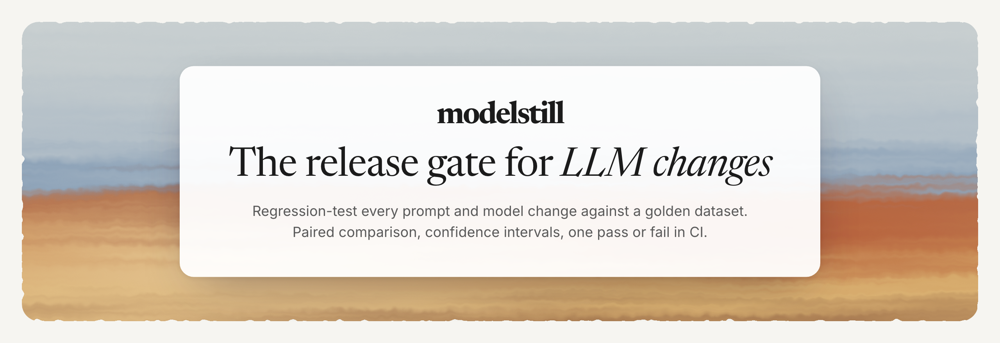
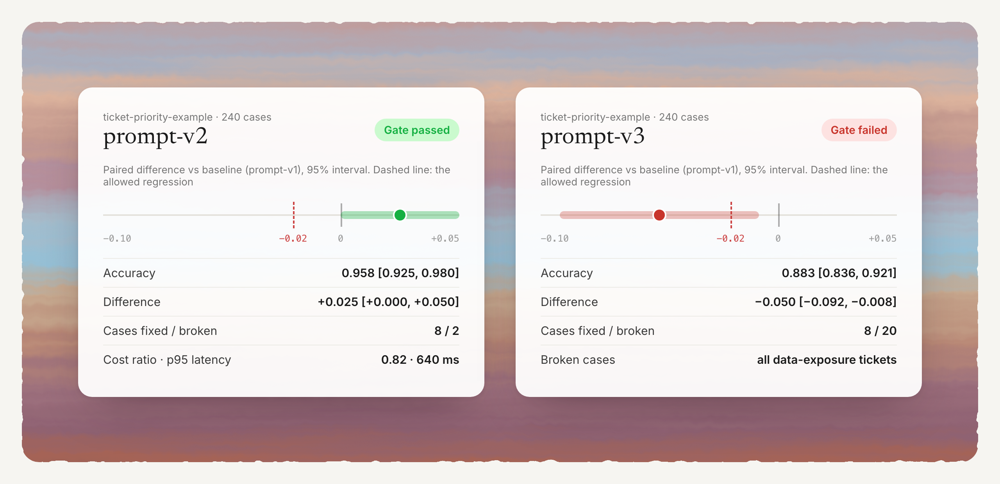
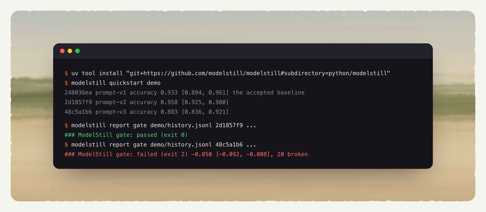

# ModelStill: the release gate for LLM changes

<p align="center"></p>

**An open-source LLM evaluation framework for CI.** Regression-test every prompt and model change against
a golden dataset, score it with exact checks or an LLM-as-a-judge you have validated against people,
and get one pass or fail: a paired comparison with the accepted baseline, with confidence intervals,
flip rate, cost and latency. Self-hosted and vendor-neutral.

[Documentation](https://docs.modelstill.com) ·
[Quickstart](https://docs.modelstill.com/quickstart) ·
[GitHub Action](#gate-every-pull-request) ·
[Website](https://modelstill.com)

**Status:** early. The Python package is not on PyPI yet: install it from this repository.

## What teams need from LLM evals, and where ModelStill fits

The same duties appear again and again in job posts for teams that ship LLM features. This is how
ModelStill covers them:

| What teams are asked to do | In ModelStill |
|---|---|
| Run regression checks on every prompt and model update | `modelstill report gate` compares the candidate with the accepted baseline case by case, with exit code 0 or 2 |
| Run evals in CI and gate releases | A GitHub Action that posts the verdict on the pull request, and a pytest plugin |
| Build golden datasets and ground truth from real data | Import the calls you already log into versioned datasets; disagreements go to a human review queue |
| Use LLM-as-a-judge where it has been validated | Judge agreement with human labels (accuracy, Cohen's kappa), verdict stability, bias correction from a few labels, pairwise judging in both orders |
| Re-run evals before a model upgrade reaches users | Model swap checks that replay recorded calls through the new model |
| Keep cost and latency in bounds | Cost ratio and p95 latency are checks in the same gate decision |
| Prompt testing: check every prompt change before it ships | `modelstill spec hash` covers the prompt file, so each prompt version is identified, scored and gated like a model change |
| Build an LLM benchmark for your own task | Versioned benchmark cases and a run history, so every model and prompt version is scored on the same cases |
| Catch hallucinations and wrong answers | Exact checks where the answer is known, or a judge rubric for faithfulness that you validate against human labels first |

## Why a gate, not just a score

<p align="center"></p>

An eval framework gives you a number. A release decision needs more than that:

- **Against what?** ModelStill compares the candidate with an accepted baseline on the same cases,
  so you see which cases it fixed and which it broke, not only the average.
- **Is the difference real?** Every score carries an interval, and the gate uses the lower bound of
  the paired difference. Noise is not mistaken for progress, or for a regression.
- **Can you trust the judge?** ModelStill measures an LLM judge against human labels (agreement,
  Cohen's kappa, false passes and fails), and the task spec refuses a judge from the same model
  family as the teacher models whose answers it checks.
- **What else changed?** The same decision checks flip rate, cost and p95 latency, and records
  every threshold and measured value so the decision can be re-read later.

## Gate every pull request

The bundled composite action runs the gate and posts the verdict as one pull request comment that
is updated on each push. It reads only the run history, so no provider key goes into the workflow.

```yaml
- uses: modelstill/modelstill/.github/actions/modelstill-gate@COMMIT_SHA
  with:
    spec: tasks/my-task/spec.yaml
    history: evals/history.jsonl
    run: ${{ steps.candidate.outputs.run }}
    baseline: ${{ vars.MODELSTILL_BASELINE_RUN }}
```

The full workflow is in [`docs/examples/modelstill-gate.yml`](docs/examples/modelstill-gate.yml)
and the details are in [the CI gate runbook](docs/runbooks/ci-gate.md).

## Works with what you already use

- **Traces:** OpenTelemetry GenAI spans, Langfuse, Braintrust, LiteLLM spend logs, any JSONL.
- **Other eval tools:** record DeepEval, Inspect and promptfoo results as runs, then compare and gate
  them with intervals.
- **CI:** GitHub Actions and pytest.
- **Serving:** a LiteLLM plugin, with the cloud model as fallback.

## What it does

- **Gate.** Compare a candidate with the accepted baseline case by case, locally or in CI. The gate
  checks quality, flip rate, cost and latency, and stores every threshold and measured value.
- **Evaluate.** Score models on versioned golden datasets with exact match, set F1, JSON equality,
  your own function, or an LLM judge. Every score carries an interval.
- **Record.** Turn the LLM calls you already log into a dataset.
- **Swap.** Replay recorded calls through another model or provider and see how often it agrees.
- **Distil.** Train a small model on recorded answers, on your own GPU host or on Modal.
- **Serve.** Put the small model behind the task's existing LiteLLM name. Roll out `off`, then
  `shadow`, then `serve`. The cloud model answers whenever the small model is not confident.
- **Watch.** Known-answer canaries and drift checks catch a model that changes behind an unchanged
  name.

## Already using another LLM eval or observability tool?

ModelStill is built to sit next to them, not to replace them:

- **LLM observability tools** such as Langfuse and OpenTelemetry-based tracing show what happened.
  ModelStill reads their traces into datasets and decides whether the next change may ship.
- **Eval tools** such as promptfoo, DeepEval and Inspect score outputs. ModelStill records their
  results as runs, then compares them with the baseline case by case and gates them with intervals.
- **Hosted platforms** such as Braintrust run evals as a service. ModelStill is a self-hosted,
  Apache-2.0 alternative for the release decision: no account, and the gate needs no provider key.

## Not built yet

These come up often and are not in ModelStill today:

- **Agent evals:** evaluation of multi-step agents and tool-calling trajectories. A task whose final
  output you can score works today; the steps in between are not scored.
- **RAG evaluation:** retrieval metrics for RAG pipelines.
- **AI red teaming:** a prompt injection and jailbreak test suite.
- **More importers:** reading runs from MLflow or LangSmith.

## How a task moves through it

1. **Spec** - one YAML file per task in `tasks/`: instruction, output schema, requirements,
   teachers, judge, golden set, gate thresholds, training, serving and monitoring settings.
2. **Label** - logged calls are labelled by two teacher models; disagreements go to a person.
3. **Train** - a small model is trained with several seeds.
4. **Score** - a judge from a different model family scores it; scores are reported with exact
   intervals.
5. **Gate** - quality lower bound, cost, latency and flip rate against the accepted baseline decide
   whether it ships.
6. **Serve** - the small model answers when its confidence is above a threshold set for a target
   error rate; otherwise the cloud model answers. Both answers are logged.
7. **Watch** - canaries and drift alarms, with a fallback to the cloud model when something breaks.

## Repository map

| Path | What it is |
|---|---|
| `python/modelstill` | The library and CLI: specs, evals, data, train, gate, serve, monitor |
| `apps/api` | TypeScript (Hono): API for the dashboard, the CLI and the MCP server |
| `apps/website` | TypeScript (Next.js): the dashboard |
| `apps/mcp` | TypeScript (Hono): MCP server over the API for coding agents |
| `apps/docs` | The documentation site; its pages are in `apps/docs/content/docs` |
| `apps/landing` | The landing page, a static site |
| `packages/*` | Shared TypeScript packages (UI, logger, telemetry, utils, redis, ClickHouse client) |
| `tasks/ticket-priority` | A small example task |
| `deploy/` | Kubernetes manifests, the LiteLLM plugin files, Modal and ClickHouse setup |
| `docs/decisions` | Architecture decision records |
| `docs/runbooks` | Operational procedures |

## Getting started

<p align="center"></p>

See the release gate pass and fail in three commands, with no API key and no network after the
install:

```bash
uv tool install "git+https://github.com/modelstill/modelstill#subdirectory=python/modelstill"
modelstill quickstart demo
modelstill report gate demo/history.jsonl 2d1857f9 \
    --spec demo/tasks/ticket-priority-example/spec.yaml \
    --previous 248036ea \
    --flip-rate 0.004 --cost-ratio 0.82 --p95-latency-ms 640
```

`modelstill quickstart demo` writes an example task with 240 generated tickets and a history with
an accepted baseline and two recorded candidates. The command above gates the first candidate and
passes (exit 0); the quickstart also prints the command for the second, which breaks a cluster of
tickets and fails (exit 2). Once ModelStill is on PyPI the first line becomes
`uv tool install modelstill`.

The quickstart in the documentation continues from there: define your own task, record a first
evaluation, compare two runs, and push the result to the dashboard. Read it at
[`apps/docs/content/docs/quickstart.mdx`](apps/docs/content/docs/quickstart.mdx), or run the docs
site:

```bash
bun install
cd apps/docs && bun run dev
```

To work on the code:

```bash
docker compose up -d
bun install
bun run test
cd python/modelstill && uv run --extra dev pytest
```

Rules for contributors and coding agents are in [AGENTS.md](AGENTS.md) and
[CONTRIBUTING.md](CONTRIBUTING.md).

## Security

Report vulnerabilities privately, as described in [SECURITY.md](SECURITY.md).

## Licence

Apache-2.0, see [LICENSE](LICENSE). Third-party code and its licences are listed in
[NOTICE](NOTICE).
